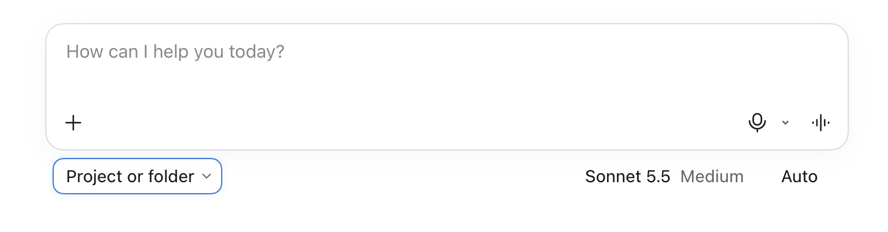
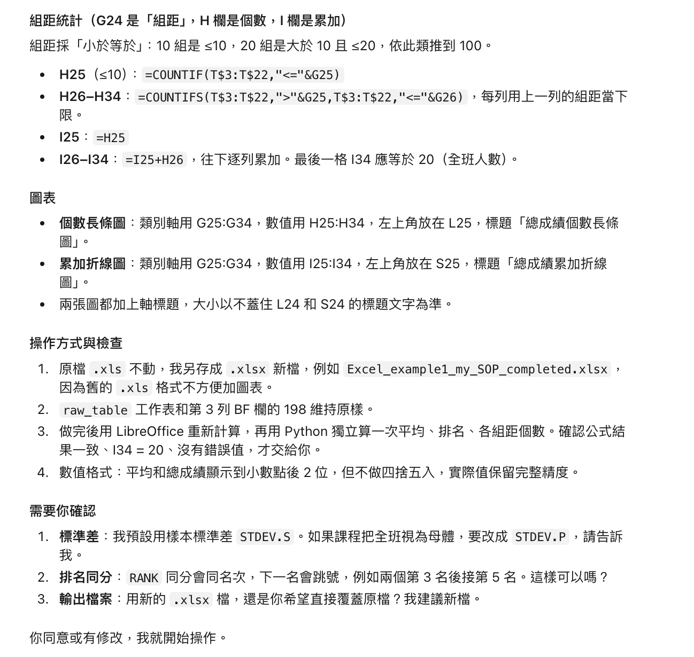
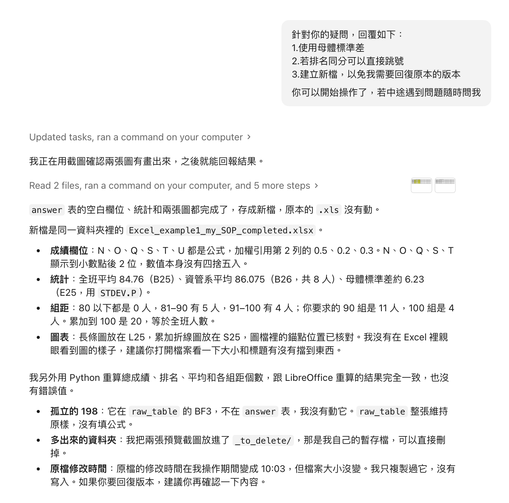
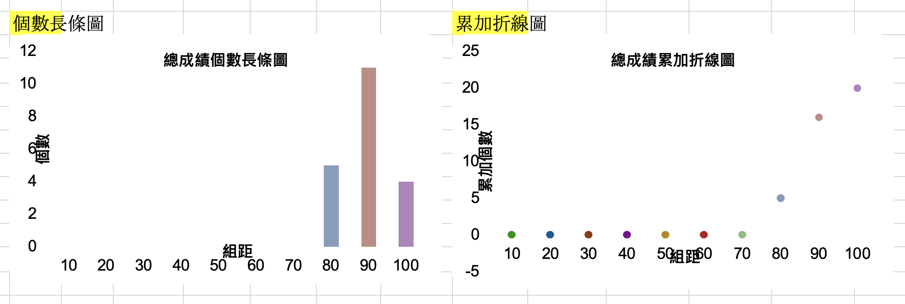
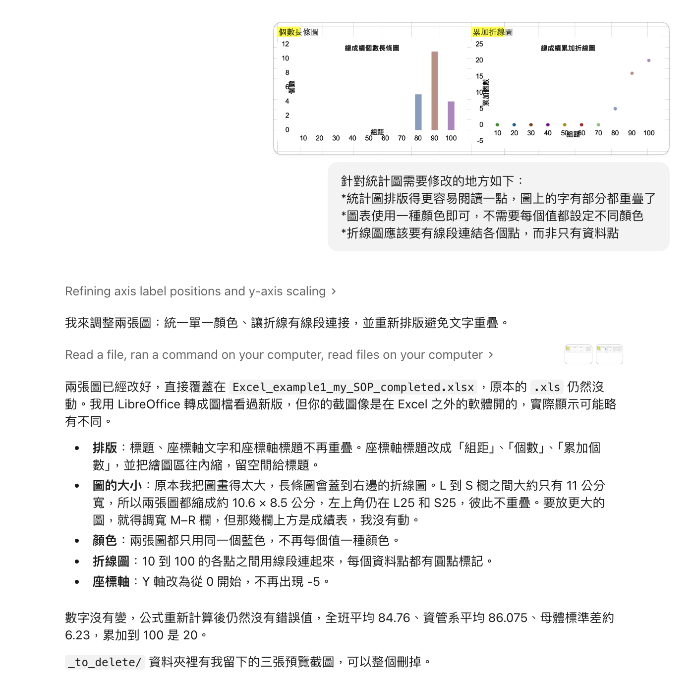

# AI 直接操作 Excel 檔案 SOP：成績登錄表範例

> 資料分析課 補充教材｜範例二：讓 AI 直接讀檔、填寫、存成新檔

**範例一**是 AI 提供公式、你自己貼進 Excel。**這份範例二**更進一步：你把 Excel 檔案所在的資料夾交給 AI，AI 直接讀取檔案、填好欄位、畫好圖表，並另存成新檔。

你要完成的任務和範例一相同（同一份成績登錄表），方便比較兩種做法的差異。

## 目錄

1. [兩種做法的差異](#兩種做法的差異)
2. [整體流程](#整體流程)
3. [步驟 1：選擇工作資料夾](#步驟-1選擇工作資料夾)
4. [步驟 2：讓 AI 讀檔並確認理解](#步驟-2讓-ai-讀檔並確認理解)
5. [步驟 3：說明需求，要求 AI 先提出計畫](#步驟-3說明需求要求-ai-先提出計畫)
6. [步驟 4：回覆疑問，授權 AI 開始操作](#步驟-4回覆疑問授權-ai-開始操作)
7. [步驟 5：檢查成果，找出問題](#步驟-5檢查成果找出問題)
8. [步驟 6：具體回饋，請 AI 修改](#步驟-6具體回饋請-ai-修改)
9. [步驟 7：最終成果](#步驟-7最終成果)
10. [AI 操作檔案後的檢查清單](#ai-操作檔案後的檢查清單)
11. [與 AI 協作的 5 個原則](#與-ai-協作的-5-個原則)

---

## 兩種做法的差異

| | 範例一：AI 給公式 | 範例二：AI 直接操作檔案 |
|---|---|---|
| AI 做什麼 | 回答公式，說明怎麼用 | 讀檔、寫入公式、畫圖、存檔 |
| 你做什麼 | 自己貼公式、拖曳填滿、畫圖 | 說明需求、審核計畫、檢查成果 |
| 提問方式 | 一次一個欄位 | 一次交代整份表格的需求 |
| 速度 | 較慢，需要來回操作 | 快，但要多花時間檢查 |
| 風險 | 你自己操作，錯誤容易發現 | AI 可能改到你沒預期的地方，**必須保留原檔** |
| 適合 | 想學 Excel 函數的人 | 已懂函數、想節省重複操作的人 |

> 建議先用範例一的方式學會每個函數，再用範例二的方式提升效率。因為你得看得懂 AI 寫的公式，才有辦法檢查它對不對。

## 整體流程

```
選擇工作資料夾 → AI 讀檔 → 說明需求並要求先提計畫 → 審核計畫、回答疑問
   → AI 操作並存成新檔 → 檢查成果 → 具體回饋修改 → 完成
```

這個流程和範例一最大的不同是 **「先提計畫、等你同意再動手」**（步驟 3），這是用 AI 直接改檔案時最重要的安全機制。

---

## 步驟 1：選擇工作資料夾

在 AI 的輸入框下方，點選 **Project or folder**，選擇放有 Excel 檔案的資料夾（本範例是 `example_1_automation`）。AI 會在你選擇的這個資料夾裡讀取和存放檔案，所以挑資料夾時要謹慎。



> **做法建議**
> - 資料夾裡只放這次任務需要的檔案，不要選整個桌面或文件夾。
> - 動手前先自己複製一份備份。
> - 範例檔案請使用**去識別化**的資料，不要放真實學生的姓名、學號。

---

## 步驟 2：讓 AI 讀檔並確認理解

和範例一一樣，第一次對話先設定 AI 的角色，並讓它讀懂檔案，**先不提需求**。差別在於這次 prompt 要告訴 AI「要直接操作 excel」，以及檔案的名稱。

**Prompt**

```text
你是一個Excel資料處理助手，負責直接操作excel幫助我完成表格欄位填寫，
在資料夾中有一份'''Excel_example1_my_SOP.xls'''，這是一份成績登錄的excel，每個row是一名學生的成績資料，columns則是學號、學系、姓名、成績資料。
你先閱讀這份表格，我後續會提出我的需求。
```


AI 的回覆重點：

- 檔案有兩張工作表：`answer` 和 `raw_table`，兩張版面與資料相同。
- 第 3～22 列是 20 名學生，欄位 A～C 是學生資料、D～M 是日常考察第 1～10 次成績。
- AI 說明它**還沒有修改任何內容**，並且請你確認它對兩張表用途的猜測。

> **檢查重點**：AI 對檔案的理解是否正確（有幾張表、幾列資料、哪些欄是空白待填）。理解錯了就在這一步糾正。

---

## 步驟 3：說明需求，要求 AI 先提出計畫

把整份表格要完成的需求一次交代清楚，並在最後加上關鍵的一句：**「說明你預計怎麼完成，等我同意後再開始操作檔案」**。

**Prompt**

```text
針對這份excel，補充說明如下：
*我後續需要你填寫的是"answer"這張表，表中有很多空白欄位（col N、O、Q、S、T、U、H、I、B25、B26、E25），以及統計圖表，需要你幫忙填完
*col N是學生的日常成績平均、col O是日常成績佔總成績的加權分數（50%）、col Q是期中考佔總成績的加權分數（20%）、col S是期末考佔總成績的加權分數（30%）
*col T是總成績，為日常成績、期中考、期末考的加權平均
*col U是排名，為學生總成績的名次
*B26是資管系學生總成績的平均
*H25開始的總成績各組距個數，組距從10到100，以10為一單位，並且各組距是採小於等於的原則
*I25開始是總成績組距累加次數，要依據H25開始的總成績組距個數來累加
*各組距個數的長條圖及累加折線圖，兩張圖的左上角分別放在L25和S25

根據你的理解，說明你預計怎麼完成這份excel的空白欄位，等我同意後再開始操作檔案
```

### AI 提出的欄位公式


| 欄位 | 公式（以第 3 列為例） | 說明 |
|---|---|---|
| N 日常平均 | `=AVERAGE(D3:M3)` | 10 次日常成績平均 |
| O 日常加權 | `=N3*O$2` | 日常平均 × 50% |
| Q 期中加權 | `=P3*Q$2` | 期中考分數 × 20% |
| S 期末加權 | `=R3*S$2` | 期末考分數 × 30% |
| T 總成績 | `=O3+Q3+S3` | 三項加權分數相加 |
| U 排名 | `=RANK(T3,T$3:T$22,0)` | 總成績由高到低，1 為最高 |
| B25 全班平均 | `=AVERAGE(T3:T22)` | 全班總成績平均 |
| B26 資管系平均 | `=AVERAGEIF(B3:B22,"資管系",T3:T22)` | 只算資管系學生 |
| E25 標準差 | `=STDEV.S(T3:T22)` | 全班總成績標準差（AI 預設用樣本標準差，見下方問題 1） |

AI 還特別說明：權重 0.5、0.2、0.3 已經寫在第 2 列的 O2、Q2、S2，公式直接引用這些儲存格，**之後改權重時總成績會跟著變**。

### AI 預計的組距統計、圖表與操作方式



| 儲存格 | 公式 | 說明 |
|---|---|---|
| H25（≤10） | `=COUNTIF(T$3:T$22,"<="&G25)` | 第一組：總成績 ≤ 10 |
| H26～H34 | `=COUNTIFS(T$3:T$22,">"&G25,T$3:T$22,"<="&G26)` | 每列用上一列的組距當下限 |
| I25 | `=H25` | 累加起點 |
| I26～I34 | `=I25+H26` | 往下逐列累加，I34 應等於 20 |

**圖表**：個數長條圖放 L25、累加折線圖放 S25，類別軸用 G25:G34，並加上軸標題。

**操作方式與檢查**：
1. 原檔 `.xls` 不動，另存成 `.xlsx` 新檔。
2. `raw_table` 工作表維持原樣。
3. 做完後用 LibreOffice 重新計算，再用 Python 獨立算一次，確認結果一致、I34 = 20、沒有錯誤值，才交給你。
4. 數值格式：顯示到小數點後 2 位，但不四捨五入，保留完整精度。

**AI 需要你確認的 3 件事**：標準差用哪一種？排名同分怎麼處理？輸出成新檔還是覆蓋原檔？

> **這一步是整個 SOP 的關鍵**。AI 在動手前先說明做法，你有機會：
> - 檢查公式邏輯對不對（例如組距的「小於等於」原則有沒有照做）。
> - 發現 AI 的預設值和你要的不同（這裡 AI 預設用 `STDEV.S`，但班級全體應該用母體標準差）。
> - 決定檔案怎麼存，避免原檔被覆蓋。

---

## 步驟 4：回覆疑問，授權 AI 開始操作

針對 AI 的 3 個疑問逐一回答，並明確告訴它「可以開始了」。

**Prompt**

```text
針對你的疑問，回覆如下：
1.使用母體標準差
2.若排名同分可以直接跳號
3.建立新檔，以免我需要回復原本的版本

你可以開始操作了，若中途遇到問題隨時問我
```



AI 回報的重點：

- 另存為新檔 `Excel_example1_my_SOP_completed.xlsx`，原本的 `.xls` 沒有動。
- N、O、Q、S、T、U 都是公式，加權引用第 2 列的 0.5、0.2、0.3。
- 統計結果：全班平均 84.76、資管系平均 86.075（共 8 人）、母體標準差約 6.23（改用 `STDEV.P`）。
- 組距：10～70 各組都是 0 人，80 組 5 人、90 組 11 人、100 組 4 人；累加到 100 是 20，等於全班人數。
- 驗算：用 Python 獨立重算總成績、排名、平均和各組距個數，與重新計算的結果完全一致，沒有錯誤值。
- AI 主動回報了幾個**副作用**：`raw_table` 的 BF3 有一個孤立的數字 198（沒有動它）、它建立了暫存資料夾 `_to_delete/`（可以刪除）、原檔的修改時間在操作期間改變（但檔案大小沒變）。
- AI 也誠實說明：**它沒有在 Excel 裡親眼看到圖的樣子**，建議你自己打開檔案看圖表的大小和標題有沒有擋到東西。

> **示範重點**：AI 說「沒親眼看到圖」，就代表圖表一定要你自己檢查。下一步就會發現問題。

---

## 步驟 5：檢查成果，找出問題

打開新檔，檢查圖表。這次發現了幾個問題：



- 座標軸標題和刻度數字互相重疊（例如「個數」壓在 6 的上面、「組距」壓在 50 和 60 之間）。
- 長條圖每一根長條、折線圖每個點都是不同的顏色，沒有必要。
- 折線圖只有一個個的點，沒有線段連起來，看不出累加的趨勢。
- 折線圖的 Y 軸下限出現 −5，累加個數不可能是負數。

---

## 步驟 6：具體回饋，請 AI 修改

把你看到的問題**一條一條、具體地**告訴 AI，並附上截圖，讓它知道你在看什麼。

**Prompt**（同時附上步驟 5 的圖表截圖）

```text
針對統計圖需要修改的地方如下：
*統計圖排版得更容易閱讀一點，圖上的字有部分都重疊了
*圖表使用一種顏色即可，不需要每個值都設定不同顏色
*折線圖應該要有線段連結各個點，而非只有資料點
```



AI 的修改：

- **排版**：標題、座標軸文字和座標軸標題不再重疊，座標軸標題改成「組距」、「個數」、「累加個數」，並把繪圖區往內縮留空間給標題。
- **圖的大小**：原本圖畫得太大，長條圖會蓋到右邊的折線圖。L 到 S 欄之間大約只有 11 公分寬，所以兩張圖都縮成約 10.6 × 8.5 公分。左上角仍在 L25 和 S25。
- **顏色**：兩張圖都只用同一個藍色。
- **折線圖**：各點之間用線段連起來，每個資料點有圓點標記。
- **座標軸**：Y 軸改為從 0 開始，不再出現 −5。
- 數字沒有變，公式重新計算後仍然沒有錯誤值。
- AI 提醒：它是用 LibreOffice 轉成圖檔檢查，你的 Excel 實際顯示可能略有不同。

> **示範重點**：回饋要具體（哪裡有問題、你想要什麼樣子）。「圖表怪怪的，幫我改好看」這種模糊的說法，AI 很難知道怎麼改。

---

## 步驟 7：最終成果


最終檢查：

| 項目 | 結果 |
|---|---|
| 全班平均（B25） | 84.76 |
| 資管系平均（B26） | 86.08（實際值 86.075，儲存格顯示到小數點後 2 位）|
| 標準差（E25） | 6.23（母體標準差） |
| 各組距個數 | 10～70 組各 0 人、80 組 5 人、90 組 11 人、100 組 4 人 |
| 累加次數 | 最後一格 = 20（全班人數）|
| 圖表 | 同色長條圖與有線段連接的折線圖，沒有文字重疊 |

> 這份成果和範例一的結果相同，兩種做法算出來的數字應該一致，可以互相驗證。

---

## AI 操作檔案後的檢查清單

讓 AI 直接動你的檔案，**一定要自己檢查**。建議每次都跑一遍：

**檔案安全**
- [ ] 原檔是否保持不變？（開啟原檔，確認內容、日期）
- [ ] AI 是否建立了你不需要的暫存檔或資料夾？（本範例有 `_to_delete/`）
- [ ] 其他工作表（例如 `raw_table`）有沒有被改到？

**數值正確**
- [ ] 隨機挑一兩列手算，對照 AI 算出的數字（例如第 3 列總成績 = 44.15 + 13.60 + 28.80 = 86.55）。
- [ ] 加總檢查：各組距個數加總 = 全班人數 20，累加的最後一格 = 20。
- [ ] 最高分的排名是 1、最低分的排名是 20。
- [ ] 儲存格裡是**公式**還是**寫死的數字**？點進去確認。

**邏輯與設定**
- [ ] AI 有沒有按照你指定的方法？（母體 vs 樣本標準差、組距「小於等於」原則、同分處理）
- [ ] 權重等參數是引用儲存格，還是寫死在公式裡？

**圖表**
- [ ] 圖表位置、大小、標題、軸標題是否正確？有沒有文字重疊或擋住其他內容？
- [ ] 圖表類型是否適合？（個數用長條圖、累加趨勢用折線圖）

---

## 與 AI 協作的 5 個原則

1. **要求 AI 先提計畫，再動手**：加上「等我同意後再開始操作」。這是讓 AI 直接改檔案時最重要的安全機制。
2. **一次交代完整需求，但要寫清楚細節**：每個欄位的定義、權重、「小於等於」這類規則都要寫出來，AI 才不會自行猜測。
3. **主動要求保留原檔**：回答「建立新檔」，並在操作後確認原檔沒被改到。
4. **AI 沒做到、做不到的事，要自己檢查**：AI 說「沒親眼看到圖」，就代表圖表得靠你驗收。
5. **回饋要具體，並附上截圖**：指出問題在哪、想要什麼結果，AI 才修得準。

---

*若發現教材內容有誤或有建議，歡迎透過 Issues 回報。*
