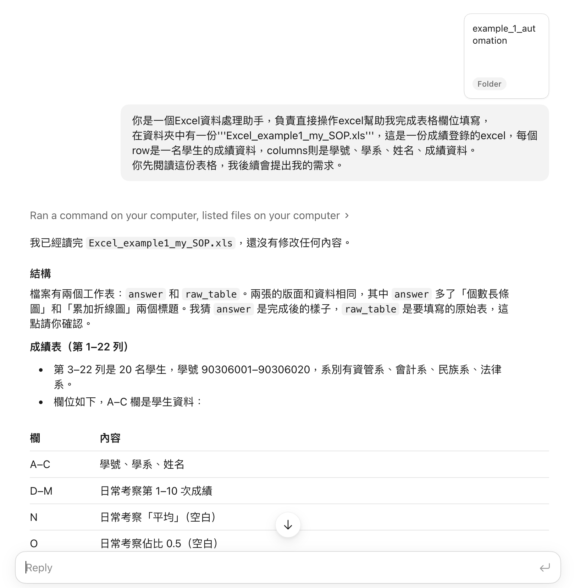
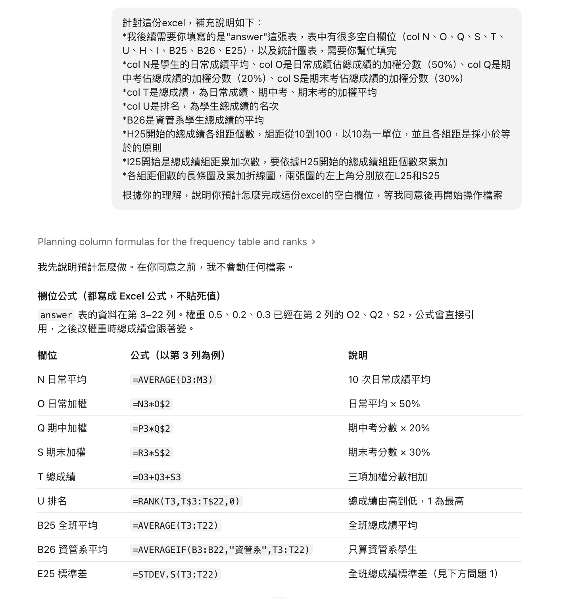
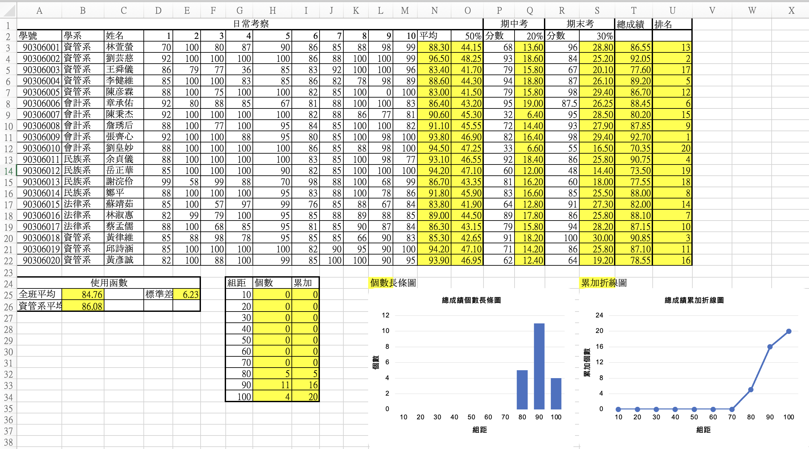

# AI 直接操作 Excel 檔案 SOP：成績登錄表範例

## 整體流程

```
選擇工作資料夾 → AI 讀檔 → 說明需求並要求先提計畫 → 審核計畫、回答疑問
   → AI 操作並存成新檔 → 檢查成果 → 具體回饋修改 → 完成
```

---

## 步驟 1：選擇工作資料夾

在 AI 的輸入框下方，點選 **Project or folder**，選擇放有 Excel 檔案的資料夾。AI 會在你選擇的這個資料夾裡讀取和存放檔案。


> **做法建議**
> - 資料夾裡只放這次任務需要的檔案，不要選整個桌面或home資料夾。
> - 動手前先複製一份備份。

---

## 步驟 2：讓 AI 讀檔並確認理解

第一次對話先設定 AI 的角色，並讓它讀懂檔案，確保 AI 的理解是正確的，**先不提需求**。

**Prompt**

```text
你是一個Excel資料處理助手，負責直接操作excel幫助我完成表格欄位填寫，
在資料夾中有一份'''Excel_example1_my_SOP.xls'''，這是一份成績登錄的excel，每個row是一名學生的成績資料，columns則是學號、學系、姓名、成績資料。
你先閱讀這份表格，我後續會提出我的需求。
```



> **檢查重點**：AI 對檔案的理解是否正確（有幾張表、幾列資料、哪些欄是空白待填）。理解錯了就在這一步糾正。

---

## 步驟 3：說明需求，要求 AI 先提出計畫

把整份表格要完成的需求交代清楚，並請 AI **說明預計怎麼完成，且等自己同意後再開始操作檔案**。

**Prompt**

```text
針對這份excel，補充說明如下：
*我後續需要你填寫的是"answer"這張表，表中有很多空白欄位（col N、O、Q、S、T、U、H、I、B25、B26、E25），以及統計圖表，需要你幫忙填完
*col N是學生的日常成績平均、col O是日常成績佔總成績的加權分數（50%）、col Q是期中考佔總成績的加權分數（20%）、col S是期末考佔總成績的加權分數（30%）
*col T是總成績，為日常成績、期中考、期末考的加權平均
*col U是排名，為學生總成績的名次
*B26是資管系學生總成績的平均
*H25開始的總成績各組距個數，組距從10到100，以10為一單位，並且各組距是採小於等於的原則
*I25開始是總成績組距累加次數，要依據H25開始的總成績組距個數來累加
*各組距個數的長條圖及累加折線圖，兩張圖的左上角分別放在L25和S25

根據你的理解，說明你預計怎麼完成這份excel的空白欄位，等我同意後再開始操作檔案
```

### AI 提出的欄位公式



| 欄位 | 公式（以第 3 列為例） | 說明 |
|---|---|---|
| N 日常平均 | `=AVERAGE(D3:M3)` | 10 次日常成績平均 |
| O 日常加權 | `=N3*O$2` | 日常平均 × 50% |
| Q 期中加權 | `=P3*Q$2` | 期中考分數 × 20% |
| S 期末加權 | `=R3*S$2` | 期末考分數 × 30% |
| T 總成績 | `=O3+Q3+S3` | 三項加權分數相加 |
| U 排名 | `=RANK(T3,T$3:T$22,0)` | 總成績由高到低，1 為最高 |
| B25 全班平均 | `=AVERAGE(T3:T22)` | 全班總成績平均 |
| B26 資管系平均 | `=AVERAGEIF(B3:B22,"資管系",T3:T22)` | 只算資管系學生 |
| E25 標準差 | `=STDEV.S(T3:T22)` | 全班總成績標準差（AI 預設用樣本標準差，見下方問題 1） |

### AI 預計的組距統計、圖表與操作方式


| 儲存格 | 公式 | 說明 |
|---|---|---|
| H25（≤10） | `=COUNTIF(T$3:T$22,"<="&G25)` | 第一組：總成績 ≤ 10 |
| H26～H34 | `=COUNTIFS(T$3:T$22,">"&G25,T$3:T$22,"<="&G26)` | 每列用上一列的組距當下限 |
| I25 | `=H25` | 累加起點 |
| I26～I34 | `=I25+H26` | 往下逐列累加，I34 應等於 20 |

**圖表**：個數長條圖放 L25、累加折線圖放 S25，類別軸用 G25:G34，並加上軸標題。

**回應 AI 需要你確認的事**：標準差用哪一種？排名同分怎麼處理？輸出成新檔還是覆蓋原檔？等

> **AI 在動手前先說明做法，你有機會：**
> - 檢查公式邏輯對不對。
> - 發現 AI 的預設值和你要的是否相同（e.g., 這裡 AI 預設用 `STDEV.S`，但需求是用母體標準差）。
> - 決定檔案怎麼存，是否直接覆蓋原檔。

---

## 步驟 4：回覆疑問，授權 AI 開始操作

針對 AI 的疑問逐一回答，並明確告訴它「可以開始了」。

**Prompt**

```text
針對你的疑問，回覆如下：
1.使用母體標準差
2.若排名同分可以直接跳號
3.建立新檔，以免我需要回復原本的版本

你可以開始操作了，若中途遇到問題隨時問我
```


---

## 步驟 5：檢查成果，找出問題

打開新檔，檢查圖表。這次發現統計圖有幾個問題：


- 座標軸標題和刻度數字互相重疊。
- 長條圖每一根長條、折線圖每個點都是不同的顏色，沒有必要。
- 折線圖只有「點」，沒有線段連起來，看不出累加的趨勢。

---

## 步驟 6：具體回饋，請 AI 修改

把你看到的問題**一條一條、具體地**告訴 AI，並附上截圖，讓它知道你在看什麼。

**Prompt**（同時附上步驟 5 的圖表截圖）

```text
針對統計圖需要修改的地方如下：
*統計圖排版得更容易閱讀一點，圖上的字有部分都重疊了
*圖表使用一種顏色即可，不需要每個值都設定不同顏色
*折線圖應該要有線段連結各個點，而非只有資料點
```


---

## 步驟 7：最終成果



- 檢查並驗收 AI 的成果，如確認公式是否正確、數字是否正確、圖表是否有誤等，確認是否與自己的需求相同。
- 若仍然有問題，再持續與 AI 對話，請 AI 調整。
- 應該要能夠看懂 AI 做了什麼，了解 AI 這樣做的目的。
